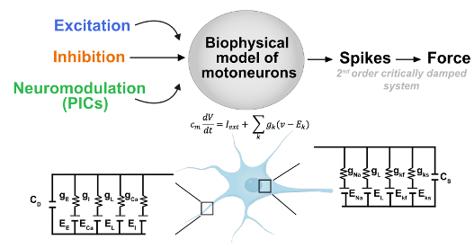
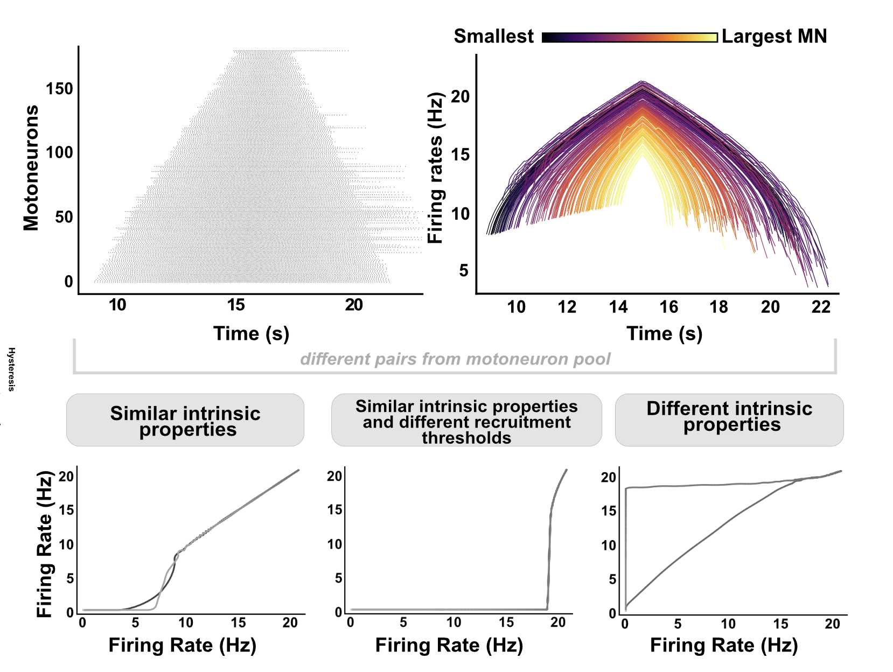

# Neuromodulation increases the flexibility of motoneuron control

In this project, we implemented a biophysical model based on the Hodgkin-Huxley equations, incorporating two compartments: a dendrite and a soma.

To verify the model's ability to replicate force-tracking tasks, we implemented a Proportional-Derivative (PD) controller, which minimizes the error between the target and actual force output.

The model was validated using experimental data from the Tibialis Anterior and Vastus Lateralis muscles of eight participants (Avrillon et al., 2024, eLife), recorded during trapezoidal isometric contractions.

As a result, our model successfully simulates the spiking activity of a motoneuron pool, accurately reproducing de-recruitment times—a variability influenced by neuromodulatory constraints originating from the brainstem.

