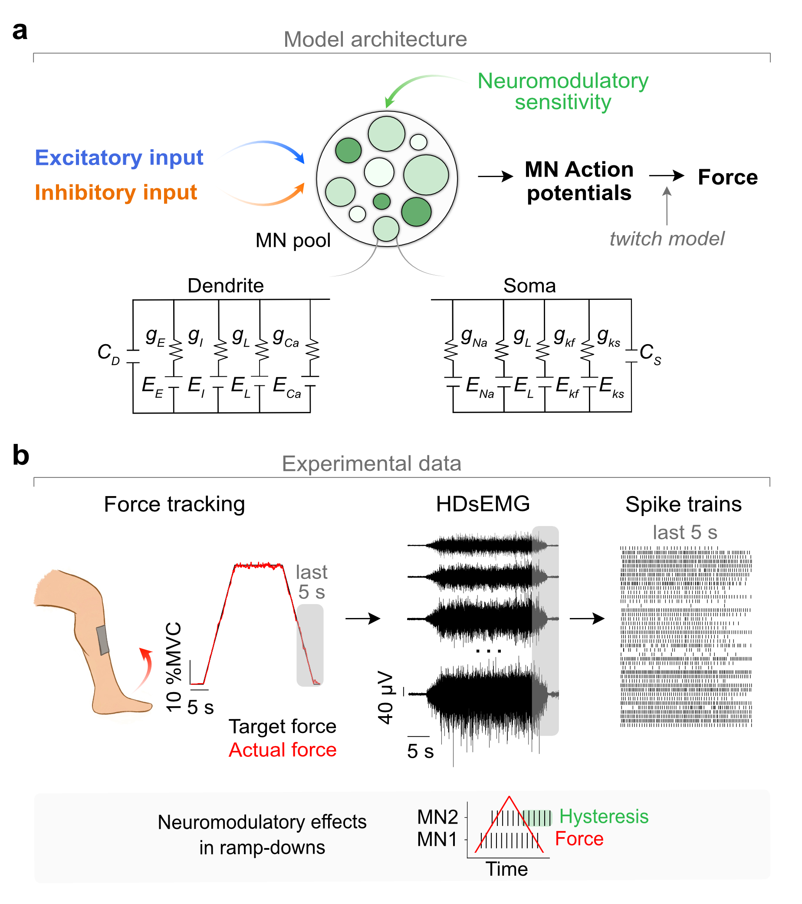
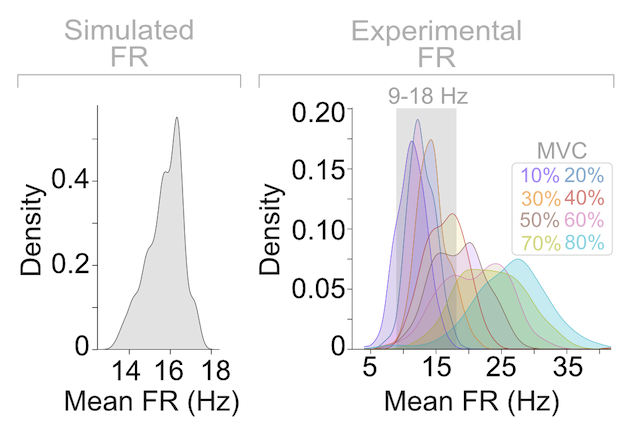
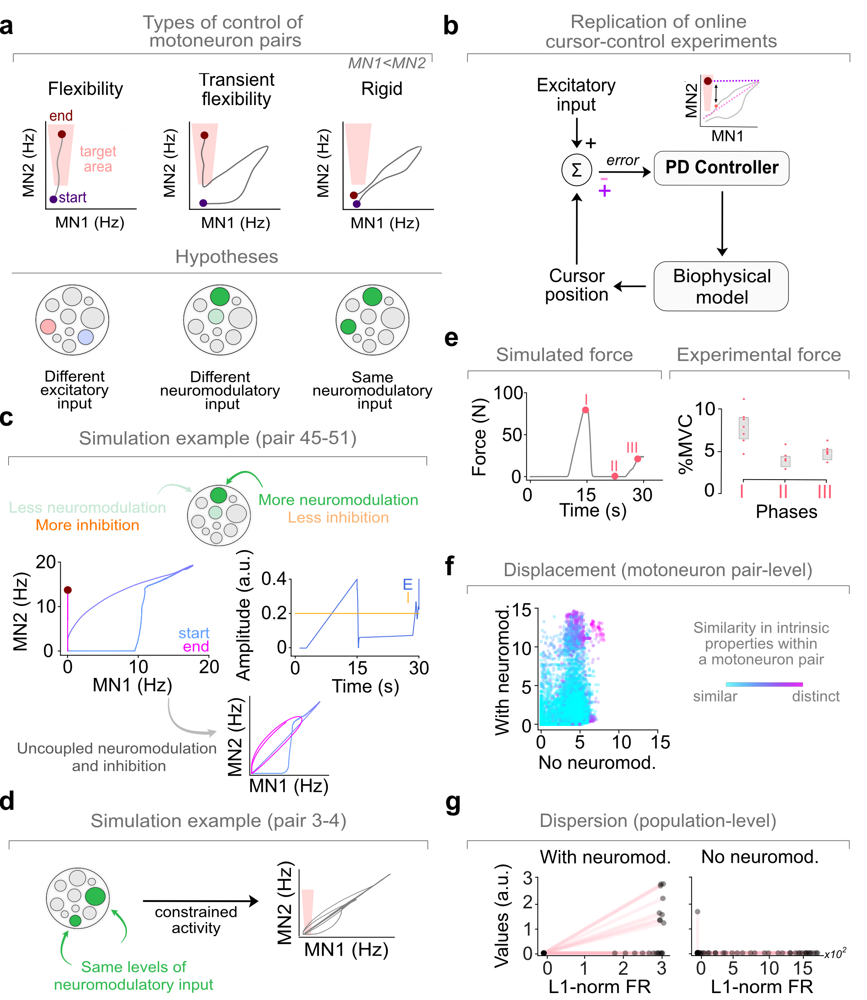

# Constraints and flexibility in motoneuron control

[](https://opensource.org/licenses/MIT)


**Can individual motoneurons be controlled flexibly despite receiving strongly shared synaptic input?**

This repository documents the computational modelling and experimental analyses underlying *Neuromodulation enables transient flexible control of motoneurons*. Using a biophysical motoneuron-pool model, human high-density surface EMG (HDsEMG), and longitudinal motor-unit neurofeedback data, we investigate how neuromodulation and inhibition shape the limits of independent motoneuron control.

**Main finding:** Heterogeneous neuromodulation can enable **transient decorrelation during derecruitment** without violating orderly recruitment. Improvements with training are consistent with learning to exploit existing control strategies rather than a fundamental reorganization of motoneuron population dynamics.

> **Code and data availability**
>
> The annotated notebooks are publicly available, but the supporting `utils/` functions and `Data_MN_Model/` inputs, outputs, and recordings are **withheld until publication**.
>
> A fresh clone cannot yet reproduce the complete analyses. The notebooks document the methods, parameters, and analysis workflow.
>
> For access inquiries, contact [n.torres-consul21@imperial.ac.uk](mailto:n.torres-consul21@imperial.ac.uk).

---

## 1. Biophysical model and experimental data

<p align="center">
  
</p>

**Figure 1 — Model architecture and experimental data.**

- **(a) Biophysical model:** A pool of two-compartment Hodgkin–Huxley motoneurons receives shared excitatory and inhibitory inputs, with heterogeneous sensitivity to neuromodulation. Dendritic persistent inward currents (PICs) influence firing hysteresis, while somatic action potentials are converted into force through a twitch-based model.
- **(b) Experimental data:** Human tibialis anterior force-tracking contractions are recorded using HDsEMG and decomposed into motor-unit spike trains. Recruitment and derecruitment dynamics provide physiological constraints for model calibration.

The framework investigates how shared excitation, inhibition, and heterogeneous neuromodulation influence motoneuron recruitment, firing, and flexibility.

Experimental recordings from eight participants provide a physiological reference ([Avrillon et al., 2024](https://elifesciences.org/reviewed-preprints/97085v1)).

---

## 2. Physiological firing rates

<p align="center">
  
</p>

**Figure 2 — Comparison of simulated and experimental firing rates.**

Simulated mean firing-rate distributions are compared with experimental recordings across contraction intensities ranging from 10% to 80% maximum voluntary contraction (MVC).

Simulated firing rates are concentrated around 14–17 Hz, within the approximately 9–18 Hz range highlighted in the experimental recordings.

This comparison supports the physiological plausibility of the simulated firing rates, rather than an exact reproduction of every experimental condition.

---

## 3. Constraints on flexible online control

<p align="center">
  
</p>

**Figure 3 — Mechanisms and limits of motoneuron-pair flexibility.**

- **(a) Control hypotheses:** Three possible regimes of motoneuron-pair control are considered: sustained flexibility, transient flexibility, and rigid coupling. Different excitatory inputs, heterogeneous neuromodulation, and shared neuromodulation represent candidate underlying mechanisms.

- **(b) Online control simulation:** A proportional–derivative (PD) controller drives the biophysical model to reproduce target cursor trajectories inspired by motor-unit neurofeedback experiments ([Bräcklein et al., 2022](https://elifesciences.org/articles/72871)).

- **(c) Transient flexibility:** Heterogeneous neuromodulation and inhibition enable transient separation of motoneuron firing rates, particularly during derecruitment.

- **(d) Constrained control:** Similar neuromodulatory effects maintain strongly coupled activity, limiting independent control of motoneuron pairs.

- **(e) Force production:** Simulated force is evaluated alongside experimental force across different phases of the online control task.

- **(f) Pair-level displacement:** The degree of firing-rate separation varies with motoneuron properties and neuromodulation.

- **(g) Population-level dispersion:** Firing-rate dispersion is compared with and without neuromodulation to evaluate its contribution to control flexibility.

**Key finding:** Transient decorrelation can emerge through heterogeneous neuromodulatory effects on derecruitment, without violating orderly recruitment under the size principle.

These results suggest that apparently flexible control need not imply fully independent recruitment of individual motoneurons.

---

## 4. Learning across days: behaviour and population coupling

<p align="center">
  
</p>

**Figure 4 — Behavioural improvements and stability of population coupling across learning.**

- **(a) Behavioural performance:** Participants improve their success rates over training, with representative force trajectories illustrating changes across sessions.

- **(b) Task performance:** Force jitter and trial duration decrease between early and late training sessions.

- **(c) Experimental population analysis:** A leave-one-motoneuron-out generalized linear model (GLM) predicts each motoneuron's spike counts from the activity of the remaining population. Cross-validated pseudo-R² measures population-based predictability across training days.

- **(d) Simulated population analysis:** The same GLM approach is applied to simulated motoneuron activity to provide a model-based comparison.

**Key finding:** Behavioural performance improves while GLM-based population predictability remains relatively stable across training.

These findings are consistent with participants refining their control strategies to exploit existing physiological flexibility, rather than requiring substantial reorganization of motoneuron population dynamics.

---

## Repository contents

| Directory | Description | Availability |
|---|---|---|
| `Notebooks/` | Documented simulation and analysis pipelines | Public |
| `assets/` | Figures illustrating the methods and results | Public |
| `utils/` | Supporting Julia and Python functions | Withheld until publication |
| `Data_MN_Model/` | Experimental recordings, model inputs, and simulation outputs | Withheld until publication |

The repository includes computational workflows for:

- Two-compartment biophysical motoneuron-pool modelling.
- Simulations of recruitment, derecruitment, and firing hysteresis.
- Analysis of heterogeneous neuromodulation and inhibition.
- Closed-loop force tracking and motoneuron-pair control.
- Comparison of simulated and experimental firing rates.
- Longitudinal motor-learning analysis using Poisson GLMs.

## Getting started

Clone the repository:

```bash
git clone https://github.com/natmtc/constraints-and-flexibility-motoneurons.git
cd constraints-and-flexibility-motoneurons
```

Open the notebooks using JupyterLab:

```bash
jupyter lab
```

The notebooks document the modelling assumptions, simulation procedures, analysis parameters, and results.

**Note:** Complete execution currently requires the supporting functions and datasets that will be released alongside publication.

---

## References and citation

**Associated manuscript**

*Neuromodulation enables transient flexible control of motoneurons.*

Preprint available; manuscript under review.

**Experimental studies**

- [Bräcklein et al. (2022)](https://elifesciences.org/articles/72871) — Longitudinal motor-unit neurofeedback and learning experiments.
- [Avrillon et al. (2024)](https://elifesciences.org/reviewed-preprints/97085v1) — Human motor-unit recordings used for physiological calibration.

If you use this repository, please cite the associated manuscript and the relevant original experimental studies.

## License

This project is licensed under the MIT License.

## Contact

For questions, collaboration, or requests for early access to supporting materials:

**Natalia T. Cónsul**  
Imperial College London  
[n.torres-consul21@imperial.ac.uk](mailto:n.torres-consul21@imperial.ac.uk)
