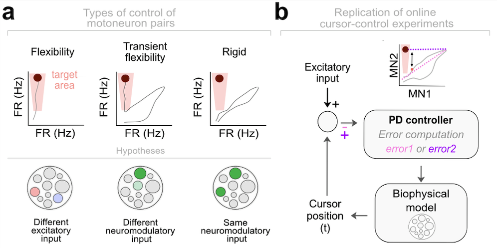

# Limits of flexible motoneuron control in unifunctional muscles

We implemented a two-compartment biophysical model of a motoneuron (Figure 1a), extending classical Hodgkin–Huxley equations to investigate the limits of flexible motoneuron control. The model reproduces the high variability observed in vivo (Figure 1b; Avrillon et al., 2024, eLife) and mimics 2D online cursor-control experiments in which participants learned to decorrelate motoneuron pairs (Bräcklein et al., 2022).

<p align="center">  </p>

Our results show that heterogeneous neuromodulatory input from the brainstem, together with uneven inhibition, can shift motoneuron behavior away from rigid correlated firing—particularly during derecruitment. These mechanisms produce decorrelation between motoneuron pairs and allow the emergence of additional controllable dimensions. Using black-box optimization, we tuned calcium channel deactivation thresholds, which regulate dendritic neuromodulatory hysteresis, achieving accurate reproduction of experimental firing-rate distributions across the motoneuron pool (Figure 2).

<p align="center">  </p>

To evaluate the model’s performance in force-tracking tasks (trapezoidal, sinusoidal, chirp), we implemented a Proportional–Derivative (PD) controller that minimizes the error between target and generated force.

The model was validated using experimental data (129 ± 44 motoneurons per subject) from the Tibialis Anterior of eight participants (Avrillon et al., 2024). The simulations successfully reproduce the collective spiking activity and force output, capturing both the mean dynamics and trial-to-trial variability observed in humans.

We next asked whether the model could reproduce the flexible behaviors reported in Bräcklein et al. (2022). A second PD controller drove the model to produce flexible behaviors (Figure 3a). Consistent with human behavior, the model showed that true independent recruitment is not achievable. Instead, apparent flexibility arises from modulating derecruitment dynamics, a strategy that respects the size principle but can momentarily create the illusion of independent control (Figure 3b).

<p align="center">  </p>

Finally, we analyzed the 14-day dataset from Bräcklein et al. (2022) (Figure 4a) to determine whether improvements in motoneuron control reflect physiological changes or behavioral adaptation. Using spiking Poisson GLM models, we tracked how pairwise motoneuron correlations evolved across learning (Figure 4b).

<p align="center">  </p>

Overall, our results show that a limited degree of flexible motoneuron control can be achieved without violating the size principle. This flexibility arises not from independent volitional access to individual motoneurons, but from neuromodulatory modulation of dendritic neuromodulation, which reshapes derecruitment thresholds and temporarily alters the relative activity of similarly tuned motoneurons. Neuromodulation therefore defines the upper bound of controllability in unifunctional muscles: it enables transient decorrelation, but does not permit arbitrary independent control.

## Features
- **Biophysical motoneuron model** based on Hodgkin-Huxley equations
- **Two-compartment structure** (soma + dendrite)
- **Heterogeneous neuromodulatory input and inhibition profiles**
- **Black-box optimization** of dendritic Ca²⁺ thresholds (VthCa)
- **Accurate motoneuron pool simulation** (spikes, force, hysteresis)
- **Force-tracking validation** (trapezoid, sinusoid, chirp)
- **PD controllers** for force control and MN-pair flexible-control tasks
- **Simulation of derecruitment dynamics** and firing-rate variability
- **Motoneuron correlation analysis over learning** (Poisson GLMs)
- **Data analysis of Bräcklein et al. (2022) experimental dataset**

## Installation and dependencies for model coded in Julia

   ```sh
   git clone https://github.com/natmtc/Motoneuron_Model.git
   cd Motoneuron_Model
```

Make sure you have Julia installed. Then, install the required packages by running:

```julia
using Pkg
Pkg.add([
    "Plots", "Distributions", "JLD", "DSP", "Parameters", "Match", "SymDict", 
    "NumericalIntegration", "Random", "MAT", "Pkg", "CSV", "DataFrames", "XLSX", 
    "JLD2", "Colors", "ColorSchemes", "Makie", "CairoMakie", "Optim", "Serialization", 
    "JuMP", "Ipopt", "Wandb", "PyCall", "Logging", "GLM", "PyPlot", "Polynomials"
])
```

## Installation and dependencies for data analysis in Python

Ensure you have **Python 3.8 or later** installed.

Run the following command in your terminal:
```sh
pip install numpy pandas seaborn matplotlib scipy scikit-learn umap-learn h5py
