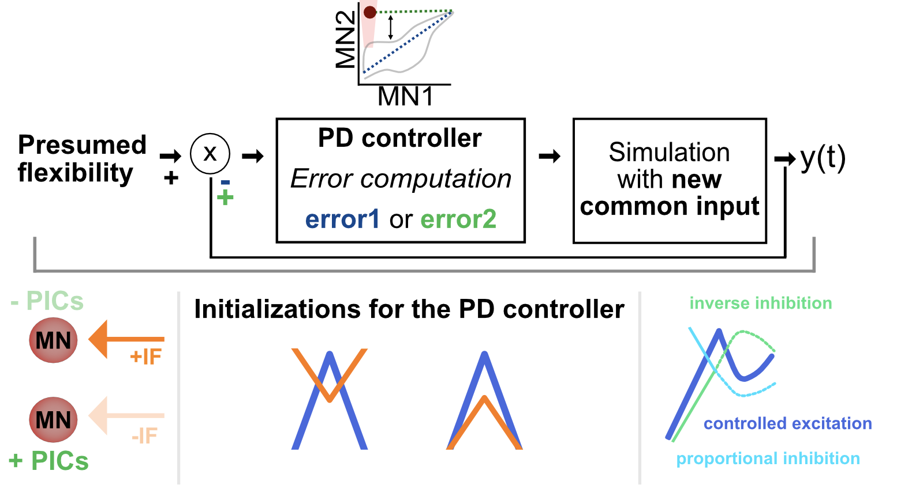

# Neuromodulation producues deviuations from rigid control

In this project, we implemented a **biophysical model** of a motoneuron based on the Hodgkin-Huxley equations, incorporating two compartments: a dendrite and a soma. 
To replicate neuromodulatory effects we optimize the voltage deactivation thresholds of Calcium channels.

<p align="center">
  
</p>

To verify the model's ability to replicate **force-tracking tasks**, we implemented a Proportional-Derivative (PD) controller, which minimizes the error between the target and actual force output.

The model was validated using experimental data from the **Tibialis Anterior** and **Vastus Lateralis** muscles of eight participants (Avrillon et al., 2024, *eLife*), recorded during trapezoidal isometric contractions.

As a result, our model successfully simulates the spiking activity of a motoneuron pool, accurately **reproducing derecruitment times variability influenced by neuromodulatory constraints** originating from the brainstem.


<p align="center">
  
</p>


Everything related to the model is implemented in Julia due to its computational efficiency, particularly for solving the Runge-Kutta 4th order (RK4) method, which allows for faster voltage computations at any time point.

Another **PD controller** was used to mimick the task described in Bräcklein et al. 2022 (eLife) where participants decorrelate the activity of pairs of motoneurons.

<p align="center">
  
</p>

Additional metrics from **Marshall et al., 2022 (*Nature*)** are incorporated in `.mat` format.

Experimental data analysis from **Mario Bräcklein's study** was conducted in **Python**, providing insights into **how neuromodulation and force evolve during learning**.

This project extensively explores how **neuromodulation enhances the flexibility of motoneuron control**, allowing independent motoneurons to decorrelate their activity.


## Features
- **Biophysical motoneuron model** based on Hodgkin-Huxley equations
- **Two-compartment structure** (soma & dendrite)
- **Force-tracking validation** 
- **Simulates spiking activity** and **derecruitment variability** in motoneuron pools
- **Learning to control neuromodulation**

## Installation and dependencies for model coded in Julia

   ```sh
   git clone https://github.com/natmtc/Motoneuron_Model.git
   cd Motoneuron_Model
```

Make sure you have Julia installed. Then, install the required packages by running:

```julia
using Pkg
Pkg.add([
    "Plots", "Distributions", "JLD", "DSP", "Parameters", "Match", "SymDict", 
    "NumericalIntegration", "Random", "MAT", "Pkg", "CSV", "DataFrames", "XLSX", 
    "JLD2", "Colors", "ColorSchemes", "Makie", "CairoMakie", "Optim", "Serialization", 
    "JuMP", "Ipopt", "Wandb", "PyCall", "Logging", "GLM", "PyPlot", "Polynomials"
])
```

## Installation and dependencies for data analysis in Python

Ensure you have **Python 3.8 or later** installed.

Run the following command in your terminal:
```sh
pip install numpy pandas seaborn matplotlib scipy scikit-learn umap-learn h5py
