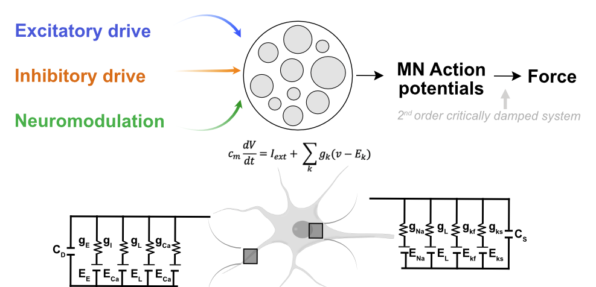
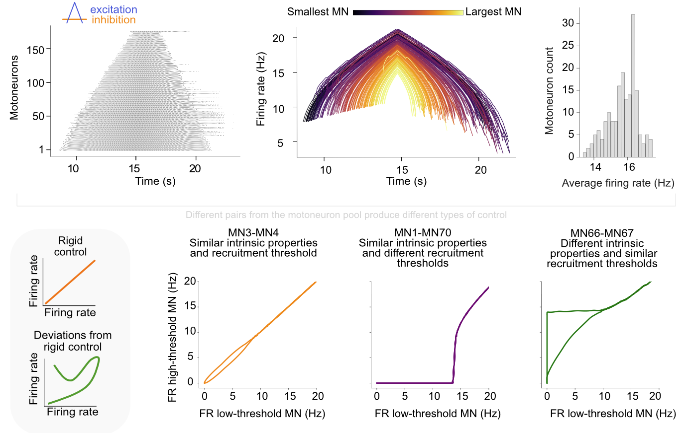
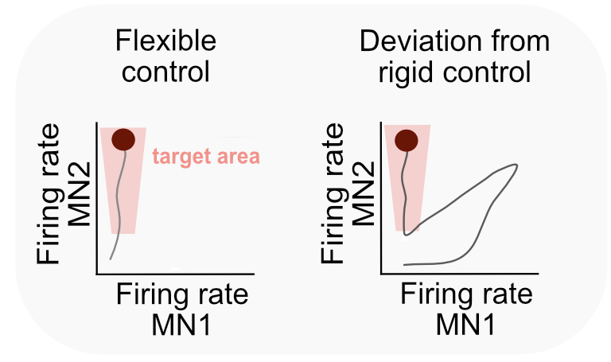
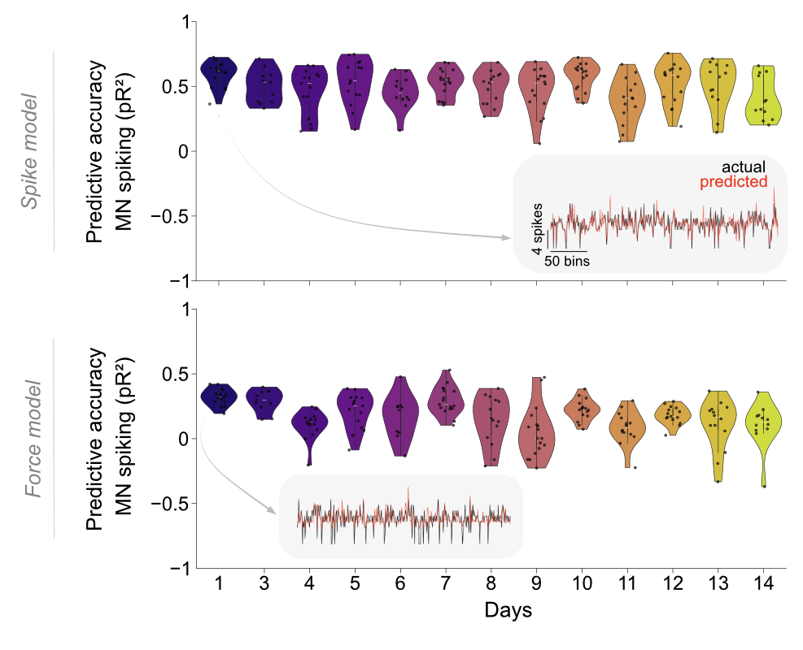

# Neuromodulation explain deviations from classic rigid control

We implemented a **two-compartment biophysical model** of a motoneuron, extending classical Hodgkin–Huxley equations to study the limits of flexible motoneuron control. The model **reproduces the high variability observed in vivo** and mimics **2D online cursor-control experiments**, where participants learned to **decorrelate motoneuron pairs with similar recruitment thresholds and intrinsic properties**.

Our results show that **neuromodulatory input from the brainstem** can shift motoneuron behavior away from rigid size-principle control, particularly during derecruitment, leading to decorrelation of motoneuron pairs and enabling control of additional degrees of freedom.

We **optimized calcium channel deactivation thresholds** (Black box optimization), which regulate the amount of hysteresis ( prolonged firing after cessation of synaptic input).


<p align="center">
  
</p>


To verify the model’s ability to replicate **force-tracking tasks** (trapezoidal, sinusoidal, chirp), we implemented a **Proportional-Derivative (PD) controller** that minimizes the error between target and actual force output.

The model was **validated with experimental data** (129 ± 44 motoneurons per subject) from the **Tibialis Anterior** muscle of eight participants (Avrillon et al., 2024, eLife). Our simulations **successfully reproduce the spiking activity of a motoneuron pool**, capturing both the collective force dynamics and the variability observed experimentally.


<p align="center">
  
</p>

Another PD controller was implemented to **reproduce the task described in Bräcklein et al., 2022 (eLife)**, where participants were instructed to **independently control pairs of motoneurons by altering their recruitment order**. In practice, true independent recruitment **was not possible** — instead, participants **achieved only apparent flexible behaviors by modulating derecruitment dynamics**, highlighting a fundamental physiological constraint.

<p align="center">
  
</p>


We also analyzed experimental data from Mario Bräcklein’s study (14-day dataset) to determine whether participants’ **improvements in motoneuron control** were driven by  **physiological changes or by behavioral adaptation** strategies. We used spiking GLM models to track how correlated activity within the motoneuron pool evolved with learning.

<p align="center">
  
</p>
This project demonstrates that the only way humans can volitionally elicit a certain degree of flexibility in motoneuron control is through neuromodulatory input, which alters derecruitment dynamics without violating the size principle.


## Features
- **Biophysical motoneuron model** based on Hodgkin-Huxley equations
- **Two-compartment structure** (soma & dendrite)
- **Force-tracking validation** 
- **Simulates spiking activity** and **derecruitment variability** in motoneuron pools
- **Motoneuron pool correlation over learning**

## Installation and dependencies for model coded in Julia

   ```sh
   git clone https://github.com/natmtc/Motoneuron_Model.git
   cd Motoneuron_Model
```

Make sure you have Julia installed. Then, install the required packages by running:

```julia
using Pkg
Pkg.add([
    "Plots", "Distributions", "JLD", "DSP", "Parameters", "Match", "SymDict", 
    "NumericalIntegration", "Random", "MAT", "Pkg", "CSV", "DataFrames", "XLSX", 
    "JLD2", "Colors", "ColorSchemes", "Makie", "CairoMakie", "Optim", "Serialization", 
    "JuMP", "Ipopt", "Wandb", "PyCall", "Logging", "GLM", "PyPlot", "Polynomials"
])
```

## Installation and dependencies for data analysis in Python

Ensure you have **Python 3.8 or later** installed.

Run the following command in your terminal:
```sh
pip install numpy pandas seaborn matplotlib scipy scikit-learn umap-learn h5py
